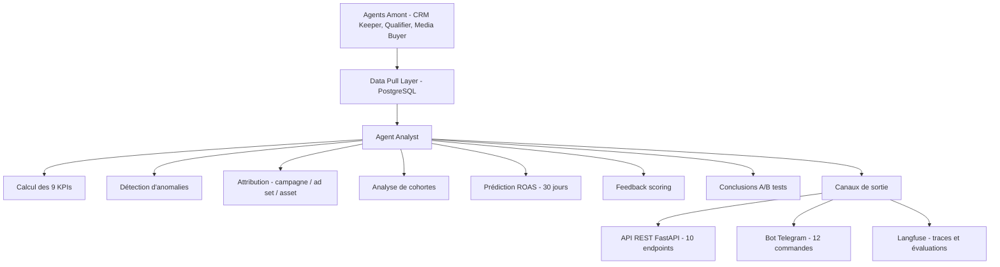

# 🤖 Agent Analyst — AI Growth Automation System

Agent Analyst est le module d'analyse et de reporting d'un système multi-agents IA destiné à l'automatisation du marketing. Il transforme les données brutes en KPIs exploitables, alertes automatiques et recommandations concrètes.

---

## 🎯 Objectifs

- **Visibilité stratégique** : 9 KPIs standardisés (CPL, CPQ, CPQL, CPBD, ROAS, taux de conversion, temps de premier contact, taux de réponse, taux de présence).
- **Détection automatique des dérives** : alertes en cas de baisse > 50 % (volume minimum : 20 leads).
- **Actionnabilité** : recommandations concrètes avec données chiffrées.
- **Traçabilité** : observabilité complète via Langfuse.

---

## 🏗️ Architecture



---

## 🛠️ Stack technique

| Composant | Technologie |
|---|---|
| Langage | Python 3.14 |
| Framework API | FastAPI (10 endpoints REST, Swagger) |
| Base de données | PostgreSQL (prod), SQLite (dev) |
| ORM | SQLAlchemy |
| Observabilité | Langfuse |
| LLM | DeepSeek / OpenRouter via LiteLLM |
| Interface conversationnelle | Telegram Bot API (12 commandes) |
| Scheduler | APScheduler (7 jobs hebdomadaires) |
| Gestionnaire de paquets | UV |
| Déploiement | VPS OVH (Ubuntu 24.04), systemd, ngrok |

---

## 📦 Modules internes

| Module | Rôle |
|---|---|
| `api.py` | API REST FastAPI (10 endpoints) |
| `agent.py` | Classe core AnalystAgent |
| `reporting.py` | Construction des rapports KPI |
| `attribution.py` | Ventilation des performances par source |
| `predictive_roas.py` | Prédiction ROAS à 30 jours |
| `cohort_analysis.py` | Analyse de cohortes |
| `scoring_feedback.py` | Propositions de recalibration |
| `ab_test_conclusions.py` | Conclusions statistiques des A/B tests |
| `telegram_report.py` | Bot Telegram + scheduler |
| `data_pull.py` | Extraction des données (SQL) |

---

## 🚀 Installation

### Prérequis

- Python 3.11+
- PostgreSQL 14+
- UV (gestionnaire de paquets)

### Étapes

```bash
# Cloner le dépôt
git clone https://github.com/abderrahmanamaoulouden533-ops/ai-growth-agent-analyst.git
cd ai-growth-agent-analyst

# Installer les dépendances
uv sync

# Configurer les variables d'environnement
cp .env.example .env
# Éditer .env avec vos propres valeurs

# Lancer l'API FastAPI
uv run uvicorn agents.analyst.api:app --host 0.0.0.0 --port 8008

# Lancer le bot Telegram
uv run python agents/analyst/telegram_report.py
```
---

## 🔌 API REST — Endpoints principaux

| Endpoint | Méthode | Description |
|---|---|---|
| `/health` | GET | État du service |
| `/report` | GET | Rapport KPI hebdomadaire |
| `/weekly-report` | GET | Rapport d'optimisation |
| `/attribution` | GET | Attribution par source |
| `/predictive-roas` | GET | Prédiction ROAS 30 jours |
| `/cohorts` | GET | Analyse de cohortes |
| `/scoring-feedback` | GET | Feedback du scoring |
| `/ab-tests` | GET | Conclusions A/B tests |
| `/conversion-api-payload` | GET | Payload Conversion API |

Documentation interactive : `http://localhost:8008/docs` (Swagger UI)

---

## 🤖 Bot Telegram — 12 commandes

| Commande | Description |
|---|---|
| `/start` | Message de bienvenue |
| `/help` | Liste des commandes |
| `/health` | État du système |
| `/report` | KPIs hebdomadaires |
| `/weekly_report` | Rapport d'optimisation |
| `/alerts` | Détection d'anomalies |
| `/observe` | Lien vers les traces Langfuse |
| `/landing` | Performance des landing pages |
| `/predict` | Prédiction ROAS 30 jours |
| `/cohort` | Analyse de cohortes |
| `/scoring` | Feedback du scoring |
| `/abtest` | Conclusions A/B tests |

---

## 🧪 Tests

```bash
uv run pytest
```

**125 tests unitaires** (100 % passants) couvrant :

- Calcul des 9 KPIs
- Attribution par source
- Prédiction ROAS
- Endpoints API
- Mécanismes de fallback

---

## 📊 KPIs calculés

| KPI | Formule | Périodicité |
|---|---|---|
| CPL | Dépenses / Soumissions | Hebdomadaire |
| CPQ | Dépenses / Leads score ≥ 31 | Hebdomadaire |
| CPQL | Dépenses / Leads score ≥ 61 | Hebdomadaire |
| CPBD | Dépenses / RDV réservés | Hebdomadaire |
| ROAS | Revenus / Dépenses | Hebdomadaire |
| Taux de conversion | % progression entre étapes | Hebdomadaire |
| Temps 1er contact | Minutes soumission → 1er message | Quotidien |
| Taux de réponse | % réponses dans 48h | Hebdomadaire |
| Taux de présence | % RDV honorés | Hebdomadaire |

---

## 📁 Structure du projet

```
agent-analyst-phaseA/
├── agents/
│   └── analyst/
│       ├── api.py
│       ├── agent.py
│       ├── reporting.py
│       ├── attribution.py
│       ├── predictive_roas.py
│       ├── cohort_analysis.py
│       ├── scoring_feedback.py
│       ├── ab_test_conclusions.py
│       ├── telegram_report.py
│       └── data_pull.py
├── common/
│   ├── db.py
│   ├── logging.py
│   ├── metrics.py
│   └── tracing.py
├── config/
│   └── settings.py
├── docs/
├── migrations/
├── scripts/
├── tests/
├── pyproject.toml
└── README.md
```

---

## 📈 Résultats

- **14 fonctionnalités majeures** livrées
- **3 phases** (A, B, C) complétées
- **125 tests unitaires** (100 % passants)
- **40+ pages** de documentation
- **Agent opérationnel** en production

---

## 👤 Auteur

**Abderrahman Amaoulouden** — Étudiant Ingénieur IA & Data (EMSI)

- LinkedIn : [abderrahman-amaoulouden](https://linkedin.com/in/abderrahman-amaoulouden)
- GitHub : [@abderrahmanamaoulouden533-ops](https://github.com/abderrahmanamaoulouden533-ops)

---

## 📄 Contexte

Ce projet a été développé dans le cadre d'un stage chez **Aphelionex Innovations** (juillet – septembre 2026) sur le système **AI Growth Automation**.

---

⭐ Si ce projet vous intéresse, n'hésitez pas à laisser une étoile sur le dépôt !
